# Hi, I'm Diogo 👋
### Full-Stack Developer | ShadowDev

I'm a **Full-Stack Developer based in Portugal**, passionate about building modern, scalable, and user-focused digital experiences.

I enjoy transforming ideas into functional applications, exploring new technologies, and continuously improving my skills. My focus is on writing clean, maintainable code and creating solutions that balance performance, usability, and thoughtful design.

### About Me

- 🇵🇹 Based in Portugal
- 💻 Focused on full-stack web development
- 🚀 Passionate about building innovative digital products
- 🌐 Portfolio: [shadowdev.xyz](https://shadowdev.xyz)
- 📬 Contact: [shadow@shadowdev.xyz](mailto:shadow@shadowdev.xyz)

<!-- cool-readme:start -->

<picture>
  <source media="(prefers-color-scheme: dark)" srcset="stats/summary-dark.svg">
  
</picture>
<picture>
  <source media="(prefers-color-scheme: dark)" srcset="stats/languages-dark.svg">
  
</picture>

<picture>
  <source media="(prefers-color-scheme: dark)" srcset="stats/contributions-dark.svg">
  
</picture>
<picture>
  <source media="(prefers-color-scheme: dark)" srcset="stats/weekly-dark.svg">
  
</picture>

<!-- cool-readme:end -->
